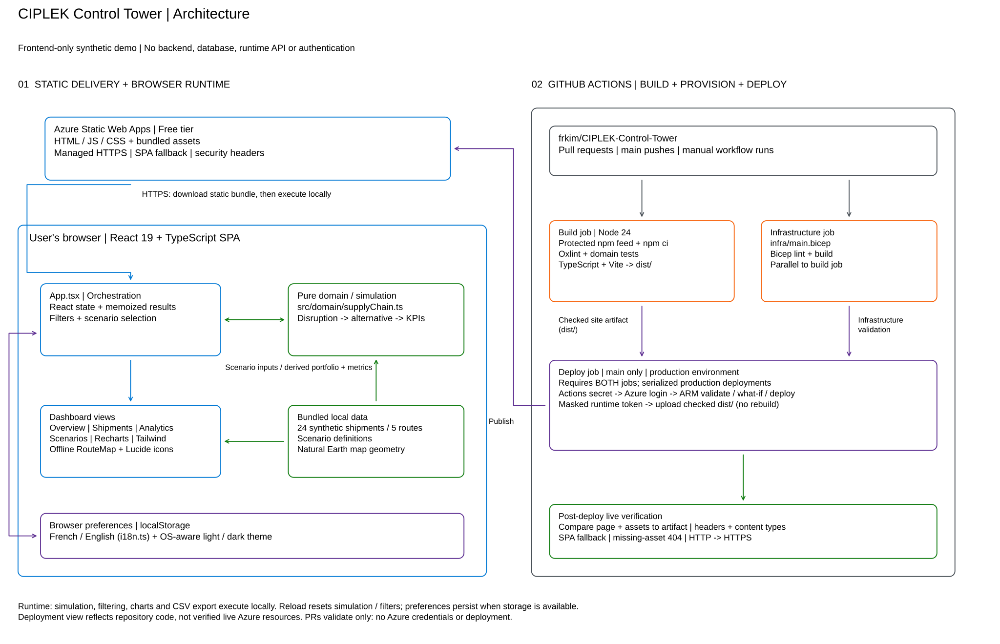

# CIPLEK · Supply Chain Control Tower

A responsive, frontend-only supply chain workspace for CIPLEK. **All shipments, people, values, events, and forecasts are synthetic.** This is a decision-support demonstration, not a live operational or authentication system.

## Run locally

Use Node.js 24 LTS and its bundled npm.
Run `nvm use` to select the same version as CI. The repository `.npmrc` selects
the [Microsoft-protected npm feed](https://packagefeedproxy.microsoft.io/npm/)
and prevents npm from rewriting locked package hosts. Before installing, verify
the effective default and scoped registries, npm settings, and lockfile sources;
the check runs locally without downloading packages. It requires the version 3
`package-lock.json` and rejects an `npm-shrinkwrap.json` that would override it.
If a package is unavailable on the protected feed, use the approved CFS
exception process rather than switching registries.

```sh
node scripts/verify-npm-feed.mjs
npm ci
npm run dev
```

Open the local URL printed by Vite. No backend, API keys, account, external fonts, or runtime data services are required.

```sh
npm run lint     # Scaffold-provided Oxlint checks
npm test         # Deterministic business-logic tests using Node's built-in runner
npm run build    # Strict TypeScript checks and production bundle
npm run preview # Serve the production bundle locally
```

Deploy the generated `dist/` directory to a static web host. Configure HTTPS and appropriate security headers on that host; the application does not implement a server.

## CI/CD on Azure

The [CI/CD workflow](.github/workflows/ci-cd.yml) runs lint, tests, a production
build, and Bicep lint/build on pull requests, pushes to `main`, and manual runs.
The build checks the npm feed configuration and lockfile sources before `npm ci`.
Only successful runs on `main` deploy, using the exact checked build artifact.
Pull requests never receive Azure credentials or deploy. Production deployments
are serialized rather than cancelled midway.

The checked-in workflow targets **Azure Static Web Apps, Free tier**, with managed
HTTPS, SPA fallback, and security headers in `public/staticwebapp.config.json`.
Its presence does not establish that a site is online. Before provisioning, confirm
that the target subscription permits a supported Static Web Apps region. Bicep
manages the site; no backend, paid App Service plan, or additional stored
deployment token is needed.

### One-time setup

1. Prefer one-time manual creation of `rg-ciplek-towercontrol` in `eastus2`, in
   the **same `subscriptionId` as `AZURE_CREDENTIALS`** (see troubleshooting below).
   Register the `Microsoft.Web` resource provider if it is not already registered.
2. Give the deployment service principal **Contributor on that resource group**,
   not the whole subscription. This permits ARM deployment and retrieving the
   Static Web Apps deployment token; the app itself has no Azure identity or data access.
3. Add the Actions secret **`AZURE_CREDENTIALS`**, containing the Azure login JSON
   fields `clientId`, `clientSecret`, `subscriptionId`, and `tenantId`. Never commit
   this JSON. This is the issue-requested exception to the linked standards'
   OIDC preference; migrate to federated identity when that requirement changes.
4. Configure these Actions variables in the repository or `production` environment:

   | Variable | Value |
   | --- | --- |
   | `AZURE_RESOURCE_GROUP` | `rg-ciplek-towercontrol` |
   | `AZURE_STATIC_WEB_APP_NAME` | `ciplektowercontrol` |
   | `AZURE_LOCATION` | `eastus2` |

   These are the target deployment values. The workflow default remains
   `westeurope` when `AZURE_LOCATION` is unset. Actions variables configure the
   workflow; they do **not** create Azure resources.

5. Create the GitHub **`production` environment**, require reviewers, and restrict
   deployment branches to `main`. These protections must be configured in GitHub;
   naming an environment in workflow YAML does not enable them.
6. Merge the workflow into `main`, then use **Actions → CI/CD → Run workflow → main**
   (or `gh workflow run ci-cd.yml --ref main`).

Deployment validates ARM parameters, prints a Bicep `what-if`, provisions the
site, and retrieves a runtime-only masked deployment token via `AZURE_CREDENTIALS`.
The deploy action skips rebuilding. The final step fetches the public HTTPS page,
all bundled `assets/` files, the theme script, and the favicon and compares them
with the build artifact. It also checks configured security headers, content
types, SPA navigation fallback, missing-asset 404s, and HTTP-to-HTTPS redirects
for every checked URL. It retries transient network errors and mismatched
content, content types, or security headers during rollout; a persistent
failure or stale deployment fails the job. The HTTP probes use the same
hostname and paths as the HTTPS requests. For hosts with
different nonstandard HTTP and HTTPS ports, set `APP_HTTP_URL` when running the
verifier manually; it must use the same hostname and base path as `APP_URL`.
After a successful check, the verified URL appears in the run summary. The
production environment may show a deployment URL even if verification fails.
Open the verified URL and exercise navigation, theme switching, shipment
filtering, and scenario simulation for an interactive acceptance check.

The Actions `AZURE_CREDENTIALS` secret is unavailable during local validation. A passing local build
does not establish that an Azure deployment has succeeded; check the actual Actions
run and its live verification step after configuring the above.

### ResourceGroupNotFound after Azure login

Successful login does not prove that `rg-ciplek-towercontrol` exists in the selected
subscription. A missing group **or the wrong subscription** can cause ARM group
validation to fail with `ResourceGroupNotFound`.

The preferred least-privilege fix is for an authorized operator to create the group
once, selecting the `subscriptionId` from `AZURE_CREDENTIALS`:

```sh
az account set --subscription "<subscriptionId-from-AZURE_CREDENTIALS>"
az account show --output table
az group create --name rg-ciplek-towercontrol --location eastus2
```

Ensure the deployment identity has **resource-group-scoped Contributor** on the
created group. Then retry **Actions → CI/CD → Run workflow → main**
(or `gh workflow run ci-cd.yml --ref main`).

Optional automatic first-run group bootstrap requires the deployment identity to
already have subscription-scope permission for
`Microsoft.Resources/subscriptions/resourceGroups/write`. Resource-group-scoped
Contributor does **not** provide this permission to create a missing group.
The workflow's bootstrap step runs immediately after Azure login and before ARM validation:
it logs `az account show`, queries `az group exists`, and only when the group is
missing runs
`az group create --name "$AZURE_RESOURCE_GROUP" --location "$AZURE_LOCATION" --output none`.
Existing groups are preserved. If creation is unauthorized, the step fails
explicitly and explains the manual setup rather than continuing to ARM validation.
It does not grant RBAC automatically; subscription-wide Contributor is not needed
or recommended for this setup.

## Explore

- **Overview:** animated portfolio KPIs, an interactive offline world map, delivery performance, and shipment tracking.
- **Shipments:** search shipment IDs, ports, countries, and cargo; combine status, mode, and route filters; sort columns, paginate, open details, and export the filtered portfolio as CSV.
- **Analytics:** change chart periods and compare current route-level performance.
- **Scenarios:** simulate a Suez Canal disruption and compare Cape of Good Hope, priority air freight, and Eurasian rail alternatives. Applying an alternative updates ETAs, delays, KPIs, and the map. Reset restores the exact original portfolio.
- **Theme:** the light/dark toggle follows the OS initially, then saves an explicit preference locally. The app remains usable when browser storage is blocked.
- **Language:** French is the default. Use the 🇫🇷 Français / 🇬🇧 English selector in the top-right header, beside the sun/moon theme toggle. Your choice is saved locally; switching languages preserves simulations and filters. Labels, dates, currency, search terms, and CSV reports follow the selected language.

## Simulation assumptions

The fixed November 2026 portfolio contains 24 shipments on five routes. A Suez disruption adds eight days to affected active ocean shipments; delivered shipments and unaffected routes are unchanged. Each alternative independently recovers a bounded number of days from the disrupted baseline, so switching alternatives does not compound results. Cost and CO₂ differences are illustrative estimates, not quotes or a carbon accounting model. Shipment value represents cargo value, not freight cost, and does not change with a routing scenario. Historic chart volumes are synthetic illustrative series; the on-time series reflects the current simulated portfolio rate.

## Architecture and standards



[Editable Excalidraw source](docs/assets/ciplek-architecture.excalidraw) ·
[Cloud drawing](https://excalidraw.core.microsoft/drawing/cb683877-08d8-413f-b9f6-15cb7633411e).
The diagram distinguishes the frontend-only simulation from the configured deployment
pipeline; it is not proof that Azure resources exist or that a deployment is live.

Built with React, strict TypeScript, Vite, Tailwind CSS, Lucide icons, and Recharts. The pure data/simulation layer is in `src/domain/`, the offline map is in `src/components/`, and dashboard orchestration lives in `src/App.tsx`. Local state is sufficient for this small, backend-free demonstration; reloading resets simulations and filters.

This project follows the relevant [ai-coding-standards](https://github.com/frkim/ai-coding-standards/): semantic accessible controls, keyboard interaction, reduced-motion support, persistent OS-aware themes, searchable/sortable/filterable tables, strict typing, lockfile installs, dependency review, and tested domain behavior.

**Stack decision:** the issue explicitly requests React, Tailwind, and Recharts with no backend. Vite replaces the standards' Next.js default, custom Tailwind-styled controls replace Material UI, and Recharts replaces D3. The scaffold's Oxlint and Node's dependency-free test runner are retained rather than adding overlapping tooling. Node 22.23 was available in the implementation environment; Node 24 LTS is recommended for development.

The demo profile is fictional and grants no permissions. Search input is rendered as text, CSV cells are escaped, and no credentials or real shipment information are included.

### Visual design

The proposed project palette is centralized in `src/index.css`: corporate blue and navy structure the interface, green marks positive outcomes, and orange highlights attention states. These are working project colors, not an official third-party identity. Theme-aware semantic tokens provide higher-contrast text variants in light and dark modes; the palette's medium grey is not used for small text on white. Dashboard and map styles reuse these tokens, with a 16px base, 14-16px body/control text, and larger headings. Narrow layouts reflow cards and controls rather than shrinking text, and wide data tables scroll within their panel.

### Map attribution

Map geometry is bundled locally from [Natural Earth](https://www.naturalearthdata.com/), public-domain cartographic data. Routes are schematic and must not be used for navigation.

## License

[MIT](LICENSE).
